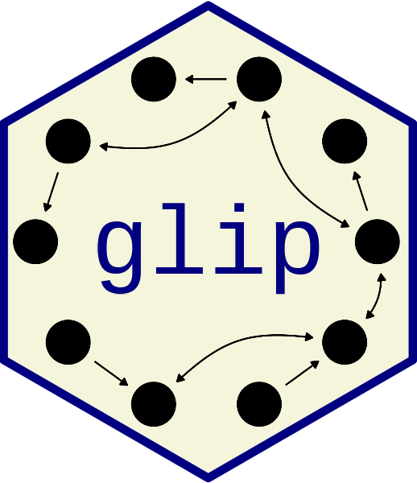

# Graph Learning via Integer Programming in R 

The **glip** package [1] provides global optimization-based algorithms for
learning (causal) graphical models from data, including Directed Acyclic Graphs
(DAGs), Acyclic Directed Mixed Graphs (ADMGs), and chain graphs (CGs). The
package relies on mixed-integer programming via GUROBI [2] for accurate,
constraint-based graph learning, with advanced support for latent variables and
complex causal graphs.

## Features

- Learn DAGs, ADMGs, DMGs, CGs directly from observational or interventional data
- Global graph optimization powered by integer programming (requires GUROBI)
- Supports various conditional independence tests (including tests from
[**comets**](https://github.com/LucasKook/comets.git) [3], `pcalg`, and `bnlearn`)
- Parallel execution for heavy workloads

## Installation

The package requires **R 4.2 or later**. `glip` itself is written in R and
has no compiler requirement, though some dependencies may need build tools or
system libraries when installed from source.

Install the Bioconductor graph dependencies, `pcalg`, and `comets`, followed by
the development version of `glip`:

```r
install.packages(c("BiocManager", "remotes"))
BiocManager::install(c("graph", "RBGL"), ask = FALSE, update = FALSE)
install.packages("pcalg")
remotes::install_github("LucasKook/comets", upgrade = "never")
remotes::install_github("LucasKook/glip", upgrade = "never")
```

To install a local checkout instead, first install the dependencies above, then
run `R CMD INSTALL .` from the repository root. This installs the package into
your R library. For a source archive, use
`R CMD build .` followed by `R CMD INSTALL glip_<version>.tar.gz`.

A working Gurobi installation and license are needed to **learn graphs**, but
are not needed merely to install `glip`.

### GUROBI Dependency

This package uses [GUROBI Optimizer](https://www.gurobi.com/) (commercial, free
for academic use) for solving mixed-integer problems crucial for global graph
learning. You must [install
](https://www.gurobi.com/documentation/quickstart.html), obtain a valid
license, and install the `gurobi` R package by following the instructions in [2].

## Quick Start Example

Learn a causal graph from toy continuous data:

```r
library("glip")

### Set seed for reproducibility
set.seed(1)

### Generate some toy data from: Y <- X -> Z
n <- 500
X <- rnorm(n)
Y <- X + rnorm(n)
Z <- X + rnorm(n)
data <- data.frame(X = X, Y = Y, Z = Z)

# Learn a DAG (using Gaussian CI test from `pcalg`)
result <- learn_graph(data, max_size = 1, mode = "dag", test = "gaussCItest", comets = FALSE)

# Inspect the learned DAG
result$graph

# Inspect the essential graph
result$computed
```

## Supported Modes

- `"dag"`: Directed Acyclic Graph (standard causal Bayesian Network)
- `"dg"`: Directed Graph (allows for cycles, used d-separation and hence assumes normal distribution)
- `"admg"`: Acyclic Directed Mixed Graph (allows for hidden confounding)
- `"dmg"`: Directed Mixed Graph (possibly cyclic)
- `"chain"`: LWF-chain graphs
- Additional experimental modes

## Cut Encoding (optional, requires Python)

For DAGs, ADMGs and chain graphs, `learn_graph(..., encoding = "cuts")`
solves the same optimization problem with a different formulation
(reachability and cutting planes), which is often much faster for larger
graphs and weak conditioning (`max_size`). It is solved by the Python
module shipped in `inst/python` with `gurobipy`:

```sh
python3 -m venv ~/glip-venv
~/glip-venv/bin/pip install -r "$(Rscript -e 'cat(system.file("python", "requirements.txt", package = "glip"))')"
```

```r
options(glip.python = "~/glip-venv/bin/python")  # or set GLIP_PYTHON
result <- learn_graph(data, mode = "dag", test = "gaussCItest", comets = FALSE,
  encoding = "cuts")
```

`gurobipy` needs a Gurobi license as well (the same license file works). The
default `encoding = "minlength"` does not need Python.

## Reproducibility

The code for the experiments of the paper [1] is in `./inst/code`, with
shell scripts to run it in `./inst/scripts`. To reproduce the results:

1. Clone this repository and install the dependencies of **glip** and
   Gurobi as described above.

2. Install the additional R and Python packages listed in
   `./inst/code/README.md` (they are needed for the competitors and the
   comparison with ASP [4]).

3. From the repository root, check the installation with
   `SMOKE=10 bash inst/scripts/reproduce.sh results/smoke`, then run all
   experiments with `bash inst/scripts/reproduce.sh results/paper`, or a
   single one with `inst/scripts/{asp,simulation,benchmark,chain}.sh`.
   Example 1 is reproduced by `bash inst/scripts/intro-example.sh`.

The figures and tables are written to `results/paper/figures` and
`results/paper/tables`. The experiments are time consuming (up to about 550
CPU hours); the scripts run the tasks in parallel on all cores and can be
restarted after an interruption. See `./inst/code/README.md` for details.

## References

[1] Kook, L., Mogensen, S. W. Exact Graph Learning via Integer Programming.
arXiv preprint arXiv:2601.20589, 2026.
[doi:10.48550/arXiv.2601.20589](https://doi.org/10.48550/arXiv.2601.20589)

[2] [Gurobi Documentation](https://www.gurobi.com/documentation/)

[3] Kook, L. & Lundborg A. R. Algorithm-agnostic significance testing
in supervised learning with multimodal data. Briefings in Bioinformatics 25(6)
2024. [doi:10.1093/bib/bbae475](https://doi.org/10.1093/bib/bbae475)

[4] A. Hyttinen, F. Eberhardt, and M. Järvisalo. Constraint-based causal
discovery: Conflict resolution with answer set programming. In Proceedings of
the 30th Conference on Uncertainty in Artificial Intelligence (UAI), 2014.

## Troubleshooting

- **Error: “Solver gurobi not available.”**
  → Ensure GUROBI and the `gurobi` R package are installed and licensed on your system.

- **Parallel execution**
  Some functions accept `parallel = TRUE` and `ncores` arguments for faster computation.

- **Raise issues or suggest features:**
  Please use [GitHub Issues](https://github.com/LucasKook/glip/issues).
